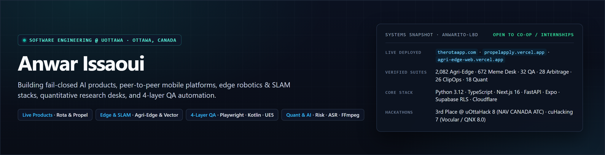

  

  
  
  
  
  

---

## Flagship Systems

<table width="100%">
  <tr>
    <td width="50%" valign="top">
      
        
      <strong><a href="https://github.com/Anwarito-lbd/rota">Rota</a></strong> · <a href="https://therotaapp.com">Live Site</a> · <a href="https://www.instagram.com/therotaapp/">@therotaapp</a>
       
      <b>Expo SDK 57 · React Native · Supabase Postgres · Stripe Connect &amp; Identity</b>
        
      Paris-first peer-to-peer wardrobe rental platform where Postgres enforces pricing, bookings, and liability invariants (<code>56</code> tables, <code>108</code> RLS policies, <code>53</code> migrations, <code>12</code> Deno Edge Functions), paired with verified <code>390×844</code> mobile walkthroughs.
    </td>
    <td width="50%" valign="top">
      
        
      <strong><a href="https://github.com/Anwarito-lbd/propel">Propel</a></strong> · <a href="https://propelapply.vercel.app/">Live App (propelapply.vercel.app)</a>
       
      <b>Next.js 16 · React 19 · Cloudflare Workers (D1 + R2) · Drizzle · Gemini · FastAPI</b>
        
      Fact-safe student career workspace querying live Greenhouse, Ashby, Lever, Remotive, and Government of Canada Job Bank feeds—zero demo fallbacks—with resume-grounded CV tailoring, PDF/DOCX exports, and a zero-key local FastAPI reference mode.
    </td>
  </tr>
  <tr>
    <td width="50%" valign="top">
      
        
      <strong><a href="https://github.com/Anwarito-lbd/agri-edge">Agri-Edge</a></strong> · <a href="https://agri-edge-web.vercel.app">Ops Station UI</a>
       
      <b>Python 3.12 · MAVLink · YOLOX-s ONNX · Next.js 16 · Leaflet · ISOXML</b>
        
      Unified RPAS companion-computer and operations platform with read-only Pixhawk telemetry, parametric flight/spray physics, 10-gate fail-closed simulation engine, and Ops PWA (<code>2,082</code> Python tests passing / <code>40</code> hardware skips, <code>124</code> Web Vitest tests, <code>22</code> compiled routes).
    </td>
    <td width="50%" valign="top">
      
        
      <strong><a href="https://github.com/Anwarito-lbd/qa-automation-suite">QA Automation Suite (AegisPay)</a></strong>
       
      <b>FastAPI + Hypothesis · Playwright &amp; Selenium · Kotlin Appium · UE5 Gauntlet · Jenkins · JIRA ADF</b>
        
      4-layer zero-flakiness QA architecture over a deterministic FinTech clearing SUT: Hypothesis stateful fuzzing (<code>18</code> tests), dual Playwright + Selenium web E2E (<code>6</code>), Python + Kotlin Appium mobile QA (<code>5</code>), Unreal Engine 5 Gauntlet log gate (<code>4</code>), and JIRA REST v3 ADF reporting (<code>32</code> pytest passing, <code>mypy</code> clean on <code>43</code> files, Gradle green).
    </td>
  </tr>
  <tr>
    <td width="50%" valign="top">
      
        
      <strong><a href="https://github.com/Anwarito-lbd/quant-finops-desk">Quant &amp; FinOps Desk</a></strong> <em>(Strictly Paper / Analytical)</em>
       
      <b>Next.js 15 · FastAPI · SciPy / HiGHS · SHA-256 AuditJournal</b>
        
      Unified portfolio risk and corporate FinOps terminal synthesizing 5 trading repositories: Markowitz Mean-Variance &amp; Mean-CVaR LP optimizer, 2-state Markov Regime-Switching Monte Carlo engine, and SaaS cohort / 5Y DCF valuation (<code>18</code> pytest, <code>ruff</code> clean, <code>vitest</code> &amp; Next build green).
    </td>
    <td width="50%" valign="top">
      
        
      <strong><a href="https://github.com/Anwarito-lbd/vector-autonomy-lab">Vector Autonomy Lab</a></strong>
       
      <b>Python 3.12 · Behavior Trees · Sobel Vision · Log-Odds SLAM · C-Space A*</b>
        
      Hardware-agnostic embodied AI &amp; robotics autonomy stack for Anki/DDL Vector (<code>track_width = 0.048 m</code>) pairing <code>VectorRobotHAL</code> (<code>SimulatedVectorRobot</code> + <code>WirePodGRPCAdapter</code>), reactive priority preemption, and Bayesian occupancy-grid SLAM mapping <code>91.9%</code> of a <code>2.4 m × 1.8 m</code> arena over <code>640</code> ticks.
    </td>
  </tr>
</table>

---

## Creative AI, Quant Research & Product Engineering

<table width="100%">
  <tr>
    <td width="50%" valign="top">
      
        
      <strong><a href="https://github.com/Anwarito-lbd/clipops">ClipOps</a></strong> · <b>FastAPI NLE Studio · WhisperX / faster-whisper · PySceneDetect · FFmpeg / Remotion</b>
       
      Short-form <code>1080×1920</code> (<code>9:16</code>) video workstation with multi-track sequence timeline, word-level transcript sync, and 4 mandatory human approval gates before manual posting (<code>26</code> pytest passing incl. E2E render).
    </td>
    <td width="50%" valign="top">
      
        
      <strong><a href="https://github.com/Anwarito-lbd/meme-flight-recorder">Meme Flight Recorder</a></strong> · <b>Strictly Paper-Only · 5-Agent Research Desk · SQLite SHA-256 Journal</b>
       
      Enforces a Read-Only Bridge (<code>write_capable=False</code>), adversarial on-chain concentration/liquidity checks, <code>L0/L1/L2</code> autonomy ceilings, and a 13-note Obsidian vault (<code>672</code> pytest passing, <code>ruff</code> clean).
    </td>
  </tr>
  <tr>
    <td width="50%" valign="top">
      
        
      <strong><a href="https://github.com/Anwarito-lbd/arbitrage-">ArbitrageX (<code>arbitrage-</code>)</a></strong> · <b>Simulated Paper Replay · FastAPI + WebSocket · Kalshi / Polymarket L2</b>
       
      Cross-venue binary arbitrage pricer and L2 VWAP slippage simulator verified on a <code>$1,000.00</code> 60-day <code>seed=42</code> simulated replay (<code>+$748.05</code> / <code>+74.81%</code>, <code>29</code> round-trips, Sharpe <code>8.59</code>, <code>28</code> pytest passing, zero live capital).
    </td>
    <td width="50%" valign="top">
      
        
      <strong><a href="https://github.com/Anwarito-lbd/MatchReady">MatchReady</a></strong> · <b>React 19 + Vite · FastAPI · SQLite WAL · Gemini Imagen / Studio DSP</b>
       
      LinkedIn portrait &amp; profile studio with 5-layer binary magic-byte upload firewall, <code>isActive</code> HTTP <code>403</code> gating, idempotent credit checkout, and deterministic fallback DSP (<code>pytest</code> <code>8/8</code>, <code>vitest</code> <code>5/5</code>, strict <code>tsc</code>).
    </td>
  </tr>
</table>

### Additional Public Repositories
- **[ConversionCraft](https://github.com/Anwarito-lbd/conversioncraft)** _(Public Showcase)_ · `conversioncraft-prod` _(Private Production)_ — Ecommerce growth OS (**Next.js 16 / React 19 + FastAPI**, `12` Prisma models, `131` OpenAPI paths, Three.js product canvas; private prod adds the **15-specialist + CC 3D Three.js office `OfficeTour.jsx`**, Leaflet sourcing map, Stripe webhooks + Fernet vault, `163` mypy files clean, `187` frontend tests passing).
- **[GitHub-Agent](https://github.com/Anwarito-lbd/Github-agent)** — Python REST v3 repository search CLI, parallel shallow cloning without credential leakage, offline ZIP research bundler, and 5-stage toolchain bootstrap (`44` catalog entries).
- **[uLink](https://github.com/Anwarito-lbd/Ulink)** — Client-side opportunity matcher across `321` normalized Canadian internships, AI roles, and uOttawa/Mitacs scholarships (`localStorage` + Playwright + Biome; succeeded by **Propel**).

---

## Core Engineering Stack

| Domain | Technologies & Tools |
| :--- | :--- |
| **Languages** | Python, TypeScript, JavaScript, SQL, Kotlin, Java, C++, Luau |
| **Web & Mobile** | Next.js (15/16), React 19, Expo / React Native, Vite, Tailwind CSS, Three.js, Leaflet |
| **Backend & Cloud** | FastAPI, Supabase Postgres (RLS + Deno Edge Functions), Cloudflare Workers (D1/R2), Drizzle ORM, Prisma, SQLite WAL, Docker / Kubernetes |
| **QA & Automation** | pytest, Hypothesis, Playwright, Selenium WebDriver, Appium / ADB (Python & Kotlin), Unreal Engine 5 Gauntlet, Vitest, Jenkins, JIRA REST v3 ADF |
| **Applied AI, Media & Quant** | Google Gemini API, Anthropic Claude API, YOLOX-s ONNX, WhisperX / faster-whisper, PySceneDetect, FFmpeg, Remotion, SciPy / HiGHS |

---

<strong>Hackathons, Private R&amp;D &amp; Academic Coursework</strong>

 

### Hackathon Collaborations
- **[NAV CANADA ATC Simulator](https://github.com/OminousOne/NAV-Canada-Simulator)** — **3rd Place @ uOttaHack 8** · Real-time air-traffic conflict-detection simulator in TypeScript ([Live](https://nav-canada-simulator.vercel.app) · [Devpost](https://devpost.com/software/atc-flight-tracker-simulator))
- **[Vocular](https://github.com/omarismail-cs/vocular)** — **cuHacking 7** · Spatial navigation &amp; item memory on QNX 8.0, Raspberry Pi 5, and TensorFlow Lite ([Devpost](https://devpost.com/software/vocular))

### Private R&amp;D Systems
- **`conversioncraft-prod`** _(Private)_ · Production ConversionCraft deployment (`OfficeTour.jsx` Three.js 3D office, Stripe billing, Fernet vault, fail-closed Fly.io/Render gates).
- **`content-factory`** _(Private)_ · 5-stage multi-model UGC &amp; faceless video workstation (`Next.js 15 + Vitest + FFmpeg`) with cut-timing invariant ad multiplier.
- **`DBTournament`** _(Private)_ · Luau/Rojo arena fighter (`Check-UI`, procedural VFX, Blender mesh pipeline) with CC BY 4.0 Obsidian brain and `export_public_showcase.py`.

### Academic Coursework (uOttawa Software Engineering)
- [`SEG3502-Lab9`](https://github.com/Anwarito-lbd/SEG3502-Lab9) _(Spring Security REST API)_ &amp; [`SEG3502-Lab10`](https://github.com/Anwarito-lbd/SEG3502-Lab10) _(Docker / Docker Compose / Kubernetes BookStore)_, plus private Angular, Spring, and Firebase labs.

